<a href="#quick-start">
  <picture>
    <source media="(prefers-color-scheme: dark)" srcset="assets/banner-dark.svg">
    
  </picture>
</a>

<p align="center">
  <a href="https://github.com/Jsolee/jsolee-kit/stargazers"></a>
  
  
  
  <a href="LICENSE"></a>
  <a href="#contributing"></a>
</p>

<p align="center">
  <a href="#quick-start"><b>Quick start</b></a> ·
  <a href="#does-it-make-a-difference">Examples</a> ·
  <a href="#the-workflow">Workflow</a> ·
  <a href="#house-rules">House rules</a> ·
  <a href="#ship-checklist">Checklist</a> ·
  <a href="#reference-library">References</a> ·
  <a href="#skill-map">Skill map</a> ·
  <a href="#mods">Mods</a> ·
  <a href="#prompts-to-try">Prompts</a> ·
  <a href="#faq">FAQ</a>
</p>

<br>

Ask Claude Code for six different things and you get one look: a warm off-white page, a serif headline with a phrase in italics, tiny mono captions, a vermilion accent, Geist. It's good. It's also what everyone else's agent shipped this morning.

**jsolee-kit is how I get out of it.** It's the skill I load for design work in Claude Code: a workflow that throws away the first idea, rules against today's default look, a ship checklist, 23 reference sites sorted by section, guides for emails and for logo and brand work, and a map of the 38 skills it points to, each linked to its source. It also ships the mod I built to watch Claude's subagents work.

It's opinionated on purpose. Fork it and make the rules yours.

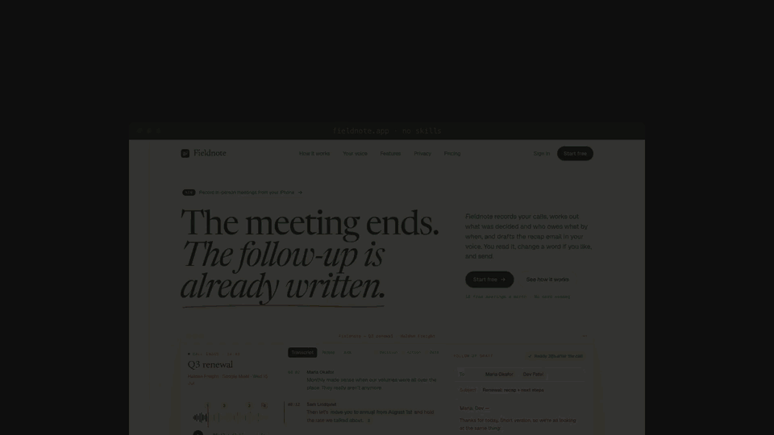
<p align="center"><sub>Silent preview. <a href="https://github.com/Jsolee/jsolee-kit/raw/main/assets/demo.mp4">Download the video with sound</a>.</sub></p>

<a href="#does-it-make-a-difference">
  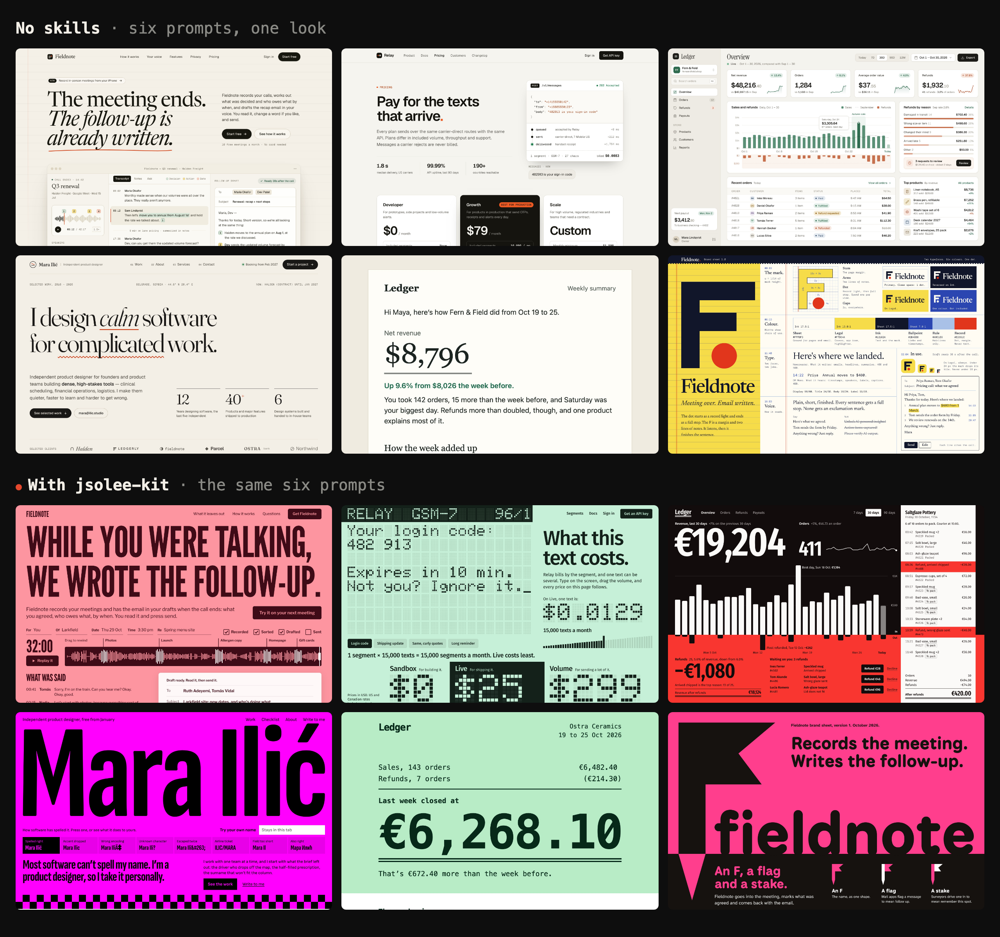
</a>
<p align="center"><sub>Same six prompts, same model, one run per side. <a href="#does-it-make-a-difference">See each pair, and how it was run.</a></sub></p>

<br>

## Quick start

Pick one. All three take under a minute.

**1 · The skill alone** (works with any agent the [`skills`](https://github.com/vercel-labs/skills) CLI supports)

```bash
npx skills add Jsolee/jsolee-kit --skill jsolee-kit -g -a claude-code
```

**2 · The skill plus the 38 skills it points to**: impeccable, taste, Emil Kowalski's design engineering, the official GSAP skills, Vercel's guidelines, Resend's email skills, logo and brand skills, React / Prisma / Expo patterns from ECC, superpowers…

```bash
curl -fsSL https://raw.githubusercontent.com/Jsolee/jsolee-kit/main/install.sh | bash
```

> [!TIP]
> Never pipe a script you haven't read. [`install.sh`](install.sh) is 30 lines: one `npx skills add` per upstream repo. Comment out what you don't want.

**3 · As a Claude Code plugin**, with the mod

```text
/plugin install jsolee-kit --marketplace Jsolee/jsolee-kit
/plugin install comunitat --marketplace Jsolee/jsolee-kit
```

Answer `y` to add the marketplace, then pick a scope. From a shell, use `claude plugin install <name> --marketplace Jsolee/jsolee-kit`. In the desktop app, click **+** next to the prompt box, then **Plugins**, **Add marketplace** with `Jsolee/jsolee-kit`, then **Add plugin**.

Then restart Claude Code and ask for UI work. The skill loads on its own when you ask to design, redesign or polish an interface, or when you ask for inspiration. You can also call it by name: `/jsolee-kit`.

<details>
<summary><b>Installing it for a whole team</b></summary>
<br>

Drop `-g` and the skills land in the project instead of your home folder. Add `--copy` so they're real files you can commit:

```bash
npx skills add Jsolee/jsolee-kit --skill jsolee-kit -a claude-code --copy
```

Everyone who clones the repo gets the same rules, without installing anything.

</details>

<br>

## Does it make a difference?

Six prompts, same model (Claude Opus 5.5), one run per side, every result published. Every page is in [`examples/`](examples): open them, they work.

**Look at the left column first.** Nobody asked for this look, and it keeps showing up: Geist in four of the five pages, a warm off-white in four, a serif headline in four, mono captions in all five. Each page is good. Together they're a uniform.

### A landing page

<p align="center">
  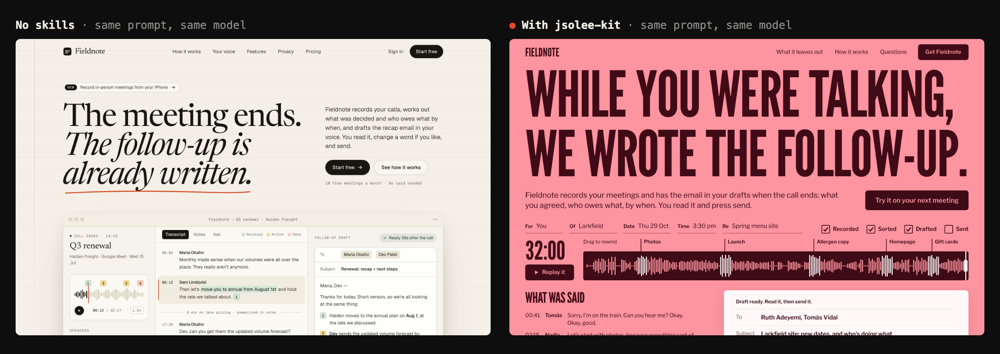
</p>

| | No skills | With jsolee-kit |
|---|---|---|
| Headline | "The meeting ends. The follow-up is already written." | "While you were talking, we wrote the follow-up." |
| The move | a serif on cream, with a hand-drawn underline | a salmon field and capitals as wide as the screen |
| The product | a picture of the app | a recording you can scrub, and the email writes itself as it plays |
| Type | Geist, Newsreader | League Gothic, Libre Franklin |
| Em dashes in the copy | 6 | 0 |

### A pricing page

<p align="center">
  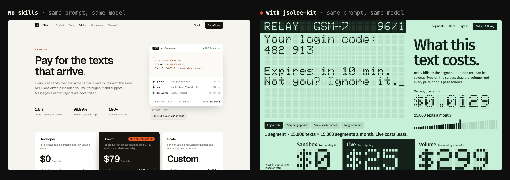
</p>

| | No skills | With jsolee-kit |
|---|---|---|
| Headline | "Pay for the texts that arrive." | "What this text costs." |
| The move | a request log in a card | the page is a phone's LCD: prices in dot matrix |
| The product | a static example | type on the screen or drag the volume, and every price on the page follows |
| Proof | numbers the page can't back up (99.99% uptime) | none |
| Em dashes in the copy | 12 | 0 |

### A dashboard

<p align="center">
  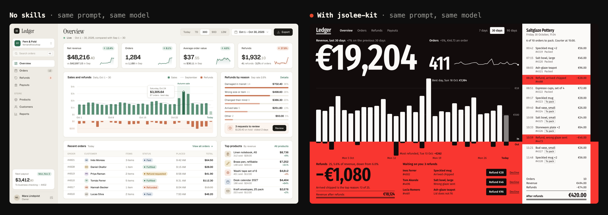
</p>

| | No skills | With jsolee-kit |
|---|---|---|
| Top of the screen | four KPI cards with sparklines | one giant revenue figure |
| The move | green and rust bars on off-white | black for money in, red for money out, split on the same axis |
| What to do next | three refund requests, in a card | "Waiting on you": each refund with its own button |

This is the loudest of the six, and the one I'd turn down first: someone has to look at it all day.

### A portfolio

<p align="center">
  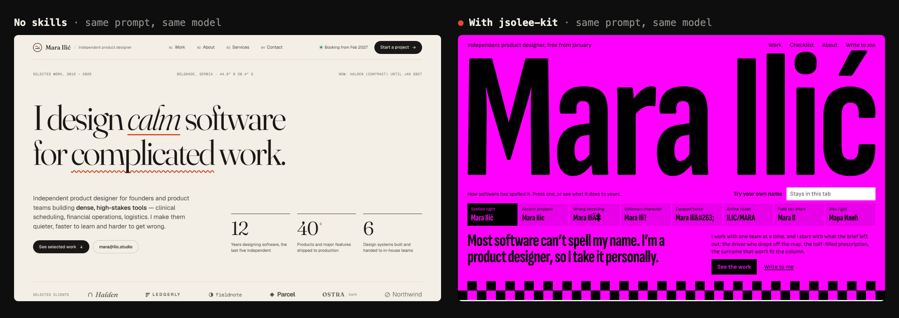
</p>

| | No skills | With jsolee-kit |
|---|---|---|
| Headline | "I design calm software for complicated work." | "Most software can't spell my name. I'm a product designer, so I take it personally." |
| The move | serif and italics, two decorated underlines | her name, as big as the screen, on magenta |
| The product | three stats and a row of client logos | type your own name and watch software mangle it (`Joan Solé`) |
| Em dashes in the copy | 25 | 0 |

### An email

<p align="center">
  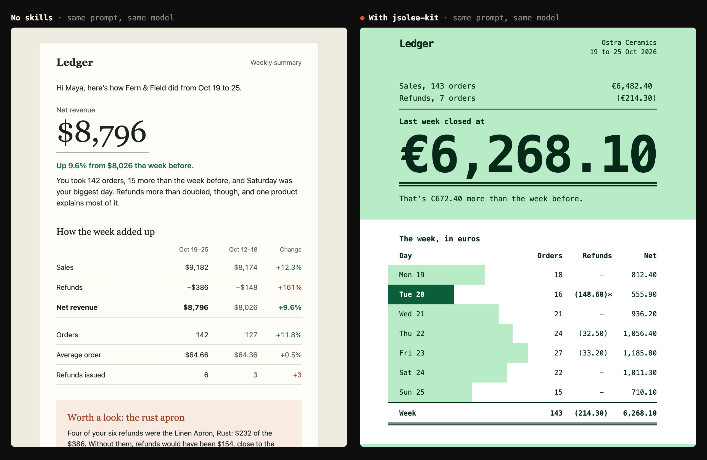
</p>

| | No skills | With jsolee-kit |
|---|---|---|
| Opens with | a greeting, then the number | sales minus refunds, then the total, like a receipt |
| The move | a cream card and a serif | mint and monospace: it reads like a ledger |
| Actions | a button and a second link | one button |
| Length | 1,865 px | 1,258 px |

Under the surface they tie: both use tables, a preheader, dark mode and Outlook fallbacks. That's what the default already gets right.

### A logo and brand

<p align="center">
  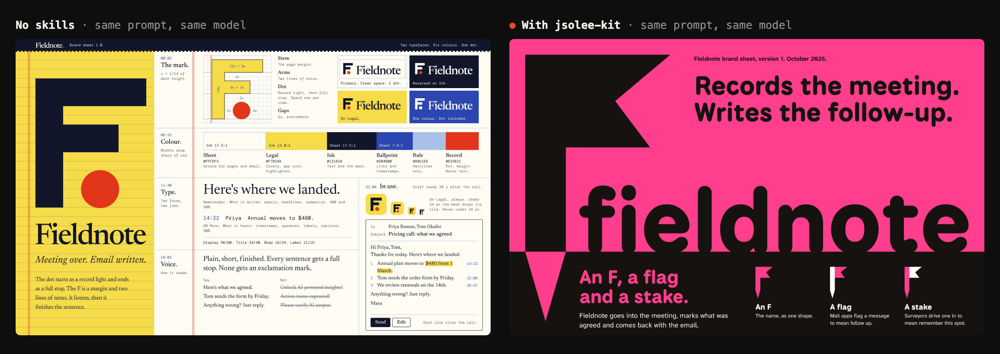
</p>

| | No skills | With jsolee-kit |
|---|---|---|
| The mark | an F with a red dot | an F that is also a flag on a stake: mail apps flag what needs a reply, surveyors stake what to remember |
| Ideas shown | one | three, in black |
| Limits | not stated | says no trademark search has been run |
| Length | one screen, as the prompt asked | more than five screens, so it misses the "one page" |

<details>
<summary><b>How this was run, and what to be skeptical about</b></summary>

<br>

```text
Build a landing page for Fieldnote, an app that records your meetings and writes the follow-up email for you.
Build a pricing page for Relay, an API for sending transactional SMS. Three plans.
Build the main dashboard screen for Ledger, an app where a small online shop owner sees revenue, orders and refunds.
Build a personal portfolio site for Mara Ilić, an independent product designer.
Build a weekly summary email for Ledger, an app where a small online shop owner sees revenue, orders and refunds.
Design a logo and a one-page brand sheet for Fieldnote, an app that records your meetings and writes the follow-up email for you.
```

- **Same constraints on both sides:** one self-contained HTML file, no raster images, and for the pages, Tailwind and Google Fonts from a CDN with everything visible on load.
- **Left:** told not to use skills, read files or browse. Never re-run.
- **Right:** told to read the kit and follow it, could load the skills it maps, and could look at screenshots of its reference galleries. No live browsing.
- **These prompts trained the rules.** I wrote the default-look rules after seeing the left column, so the kit has seen these six before. Try your own prompt.
- **The first version of the kit was much subtler.** It removed tells and kept the look. Those pages are in this repo's history.
- **Louder isn't always better.** The kit asks for one big move. On a real project you may want a smaller one: see the [FAQ](#faq).
- **It costs more.** The kit runs used about 1.8× the tokens and 2.1× the time: 36 to 75 tool calls against 2 to 10.

</details>

<br>

## What's inside

```text
jsolee-kit/
├── skills/jsolee-kit/
│   ├── SKILL.md                 workflow, skill map, house rules, ship checklist, motion tokens
│   └── references/
│       ├── inspiration.md       23 reference sites, sorted by section
│       ├── email.md             how to build emails that survive real inboxes
│       ├── brand.md             from a name to a logo and a one-page brand system
│       └── skills.md            every skill and plugin it points to, with its source repo
├── plugins/comunitat/           the mod: subagents drawn as crabs, plus a map of the repo
├── examples/                    six projects, each built with and without the kit
├── install.sh                   the kit and the 38 skills, in one go
└── .claude-plugin/              the marketplace behind /plugin install
```

`SKILL.md` stays under 100 lines on purpose. Claude reads it whole on every UI task, and the long lists sit in `references/` until a step needs them.

<br>

## The workflow

<picture>
  <source media="(prefers-color-scheme: dark)" srcset="assets/workflow-dark.svg">
  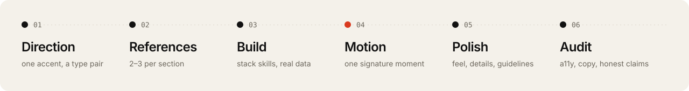
</picture>

| Step | What happens | Reach for |
|---|---|---|
| **01 Direction** | Read `PRODUCT.md` / `DESIGN.md` if the repo has them. Write three directions from something true about the product, throw away the first one you thought of, and keep the one a competitor couldn't wear. Then fix the register, one committed color and a type pair. No code yet. | `impeccable`, `design-taste-frontend` |
| **02 References** | Two or three sites per section from the [reference library](#reference-library). Write one line per site about what you're taking: layout, rhythm, type or motion. Never copy a page. | `jsolee-kit` references |
| **03 Build** | Real product, real data, real copy. Stack skills for the code. | `react-patterns`, `prisma-patterns`, `react-native-patterns` |
| **04 Motion** | One signature moment, not everything moving. GSAP for scroll and timelines, Motion for component state. | `gsap-scrolltrigger`, `motion-patterns` |
| **05 Polish** | Hit areas, focus states, optical alignment, text wrapping, the details people feel and can't name. | `emil-design-eng`, `make-interfaces-feel-better`, `web-design-guidelines` |
| **06 Audit** | Accessibility, a copy pass that removes sentences that sound like AI, and every claim checked against the product. | `impeccable` audit, `frontend-a11y` |

<br>

## House rules

**First, the default look.** Left alone, today's models converge on it. If your work could wear it, start over, unless the brand truly calls for it:

- A warm off-white background (`#f5f3ee` and friends), ruled lines or paper grain.
- A serif headline with one phrase in italics or underlined by hand.
- Tiny mono captions, numbered eyebrows, hairline rules, one vermilion dot or underline.
- Nav, headline left, blurb right, an app mockup in a card below.
- Geist, Geist Mono, Inter, Newsreader, Fraunces, Instrument Serif, DM Mono, Schibsted Grotesk, Space Grotesk.
- The usual escape is a default too: a flat yellow field with a black grotesk.

**Then, commit.** Make it obvious from across the room:

- One move you can say in five words, big enough to carry the page.
- One working thing, not a picture of it: a calculator, a live demo, a control that changes the page.
- Type from a specific place: a foundry, an era, a sign, a manual.

**And the older tells,** each one caught in my own projects, with what we do instead.

| The tell | What we do instead |
|---|---|
| Gradient text, buttons that blend two brand colors | One solid color. Emphasis comes from weight and size. |
| Glassmorphism as the default surface | Solid surfaces. `backdrop-filter` only for legibility over a busy image. |
| SaaS pill eyebrows (`bg-color/8` + `border-color/18`) | A small editorial kicker, or nothing. |
| Colored shadows (`shadow-indigo-200`) | `0 1px 3px rgba(0,0,0,.03)` on cards, `0 8px 40px rgba(0,0,0,.08)` when elevated. |
| Cards inside cards, colored side stripes | One surface level. Hierarchy comes from spacing. |
| `rounded-[2.5rem]` bubbles, `rounded-full` cards | `rounded-2xl` cards, `rounded-xl` buttons, `rounded-lg` small parts. |
| Bouncy, elastic easing | Ease-out exponential: `cubic-bezier(0.22, 1, 0.36, 1)`. |
| Indigo-only palette, radial blobs behind every hero | A neutral base and one committed accent per surface. |
| `font-black` on UI text, bold descriptions | One family, two weights, headings at `-0.02em` to `-0.04em`. |
| Hover that swaps colors | Hover that lifts: `-translate-y-0.5`. |
| Em dashes in UI copy | Commas, colons and periods. |

In practice:

```diff
- <span className="rounded-full border border-indigo-500/20 bg-indigo-500/10 px-3 py-1
-   text-xs font-semibold uppercase tracking-widest text-indigo-600">✨ New</span>
- <h1 className="bg-gradient-to-r from-indigo-500 to-purple-500 bg-clip-text
-   text-6xl font-black text-transparent">Supercharge your workflow</h1>
- <div className="rounded-[2.5rem] bg-white/10 backdrop-blur-xl shadow-2xl shadow-indigo-200">
+ <p className="font-mono text-xs text-neutral-500">Now in beta</p>
+ <h1 className="text-6xl font-semibold tracking-[-0.04em] text-neutral-950">
+   Your invoices, sent before lunch</h1>
+ <div className="rounded-2xl border border-black/[0.04] bg-white shadow-[0_1px_3px_rgba(0,0,0,.03)]">
```

<br>

## Ship checklist

What I check before a landing goes out. Every item comes from a page I had to fix.

- [ ] The hero headline fits in two lines at 1440 px, and the hero shows the actual product.
- [ ] Sections don't all open with the same eyebrow + giant title + subtitle block.
- [ ] No invented testimonials, logos, ratings or metrics.
- [ ] Prices, trial terms and structured data match what billing actually charges.
- [ ] Skip link and visible focus states.
- [ ] `translate="no"` on brand and person names.
- [ ] Non-breaking spaces between numbers and units (`14&nbsp;MB`).
- [ ] `scroll-margin-top` on anchor targets under a sticky nav.
- [ ] `touch-action` and `overscroll-behavior` wherever scroll is custom.
- [ ] Anything that loops for more than five seconds has a pause control ([WCAG 2.2.2](https://www.w3.org/WAI/WCAG22/Understanding/pause-stop-hide.html)).
- [ ] `prefers-reduced-motion` turns the signature moment into a cut.

<br>

## Motion tokens

| Name | Value | Use |
|---|---|---|
| Smooth out | `cubic-bezier(0.25, 0.4, 0.25, 1)` | General reveals |
| Expo out | `cubic-bezier(0.22, 1, 0.36, 1)` | Hero entrances, emphasis |
| GSAP | `power3.out` / `power4.out` | Card entrances / text reveals |

The reveal I reuse everywhere, with [Motion](https://motion.dev):

```tsx
import { motion, useInView, useReducedMotion } from "motion/react";
import { useRef, type ReactNode } from "react";

export function Reveal({ children, delay = 0 }: { children: ReactNode; delay?: number }) {
  const ref = useRef(null);
  const inView = useInView(ref, { once: true, margin: "-80px" });
  const reduce = useReducedMotion();
  return (
    <motion.div
      ref={ref}
      initial={reduce ? false : { opacity: 0, y: 32 }}
      animate={inView ? { opacity: 1, y: 0 } : undefined}
      transition={{ duration: 0.7, delay, ease: [0.22, 1, 0.36, 1] }}
    >
      {children}
    </motion.div>
  );
}
```

<br>

## Reference library

Pick by the section you're designing. Open two or three, write down what you're taking from each, then close the tabs and build.

| Section | Where | What to take from it |
|---|---|---|
| Whole landings | [land-book](https://land-book.com) · [One Page Love](https://onepagelove.com) · [Awwwards](https://www.awwwards.com) | Section order, pacing, how much fits above the fold |
| Heroes | [supahero.io](https://supahero.io) | Headline length, how the product shows in the first screen |
| Navbars | [navbar.gallery](https://www.navbar.gallery) | Scroll states, mobile menus, where the CTA sits |
| Social proof | [socialproofexamples.com](https://socialproofexamples.com) | Real quotes with faces, roles and numbers |
| Pricing | [pricingpages.design](https://pricingpages.design) | Plan naming, the comparison table, the annual toggle |
| Share images | [ogimage.gallery](https://www.ogimage.gallery) | OG cards that still read at 600 px |
| Email | [reallygoodemails.com](https://reallygoodemails.com) | Transactional and lifecycle emails, filtered by type |
| Logos | [Logo System](https://www.logosystem.co) · [Logobook](https://logobook.com) | Marks by shape and idea, in one color |
| Brand systems | [Brand New](https://www.underconsideration.com/brandnew) · [Branding Style Guides](https://brandingstyleguides.com) | Rebrands explained, and how real guidelines are organized |
| Decks | [deck.gallery](https://www.deck.gallery) | One idea per slide |
| Social posts | [posts.design](https://posts.design) | Carousel and post layouts |
| Ads | [adfolio.design](https://adfolio.design) | Ad layouts and hooks |

**Motion, 3D and components**

| Where | Why it's here |
|---|---|
| [igloo.inc](https://www.igloo.inc) | One 3D object that transforms with scroll, HUD labels anchored to it with lines. |
| [motionsites.ai](https://motionsites.ai) | Motion-heavy sites; "Particle Self", a bust made of particles. |
| [21st.dev](https://21st.dev) | React components and backgrounds to drop in. |
| [docs.pmnd.rs](https://docs.pmnd.rs) | React Three Fiber and drei. |
| [storytold/effectcraft](https://github.com/storytold/effectcraft) | Open source motion graphics and compositing. |
| [awesome-opus5-5-videos](https://github.com/yihui-dev/awesome-opus5-5-videos) | Code-rendered videos and the prompts behind them. The best ones are Three.js with shaders, canvas effects and long, iterated prompts. |

**Guidelines**: [Vercel Web Interface Guidelines](https://vercel.com/design/guidelines), the checklist behind step 05.

<br>

## Skill map

When you need something, this is the skill to reach for.

| You need | Reach for |
|---|---|
| Art direction, critique, audit, polish | [`impeccable`](https://github.com/pbakaus/impeccable), [`design-taste-frontend`](https://github.com/Leonxlnx/taste-skill) |
| Palettes, type pairings, UI styles per product type | [`ui-ux-pro-max`](https://github.com/nextlevelbuilder/ui-ux-pro-max-skill) |
| Micro-interactions and feel | [`emil-design-eng`](https://github.com/emilkowalski/skills), [`make-interfaces-feel-better`](https://github.com/affaan-m/ECC) |
| Vercel's interface checklist | [`web-design-guidelines`](https://github.com/vercel-labs/agent-skills) |
| Scroll, timelines, text and SVG animation | [`gsap-scrolltrigger`, `gsap-timeline`, `gsap-react`](https://github.com/greensock/gsap-skills) |
| Component and page transitions in React | `motion-foundations`, `motion-patterns` ([ECC](https://github.com/affaan-m/ECC)) |
| Accessibility | `frontend-a11y` ([ECC](https://github.com/affaan-m/ECC)) |
| React and Next.js code and performance | `react-patterns` ([ECC](https://github.com/affaan-m/ECC)), [`vercel-react-best-practices`](https://github.com/vercel-labs/agent-skills) |
| Prisma schemas and queries | `prisma-patterns` ([ECC](https://github.com/affaan-m/ECC)) |
| Expo and React Native | `react-native-patterns` ([ECC](https://github.com/affaan-m/ECC)) |
| A launch video from HTML | [`hyperframes`](https://github.com/heygen-com/hyperframes) |
| A slide deck in the browser | [`frontend-slides`](https://github.com/zarazhangrui/frontend-slides) |
| An email: transactional, lifecycle, launch | [`email.md`](skills/jsolee-kit/references/email.md), then [`react-email`, `email-best-practices`, `resend`](https://github.com/resend/resend-skills) |
| A logo and a brand identity | [`brand.md`](skills/jsolee-kit/references/brand.md), then [`brand`, `design`, `banner-design`](https://github.com/nextlevelbuilder/ui-ux-pro-max-skill), `ios-icon-gen` ([ECC](https://github.com/affaan-m/ECC)) |
| Plan, debug, prove it works | [`brainstorming`, `systematic-debugging`, `verification-before-completion`](https://github.com/obra/superpowers) |

<details>
<summary><b>The full catalog</b>: every skill the kit points to, by category</summary>
<br>

★ means `install.sh` installs it. Anything else: `npx skills add <repo> --skill <name> -g -a claude-code`.

**Design and UI**

| Skill | Repo | Use |
|---|---|---|
| ★ impeccable | [pbakaus/impeccable](https://github.com/pbakaus/impeccable) | Design vocabulary: shape, critique, audit, polish, bolder, quieter |
| ★ design-taste-frontend | [Leonxlnx/taste-skill](https://github.com/Leonxlnx/taste-skill) | Anti-slop art direction with variance, motion and density dials |
| ★ emil-design-eng | [emilkowalski/skills](https://github.com/emilkowalski/skills) | UI polish and animation decisions |
| ★ ui-ux-pro-max | [nextlevelbuilder/ui-ux-pro-max-skill](https://github.com/nextlevelbuilder/ui-ux-pro-max-skill) | Styles, palettes and font pairings per product type |
| ★ brand | same repo | Brand voice, visual identity, messaging, style guides |
| ★ design | same repo | Logo generation (needs `GEMINI_API_KEY`), corporate identity, icons, social images |
| ★ banner-design | same repo | Social covers, ads and hero banners |
| ui-styling, design-system, slides | same repo | Tokens, component styling, HTML slides |
| ★ ios-icon-gen | affaan-m/ECC | iOS app icons from SF Symbols or Iconify |
| ★ web-design-guidelines | [vercel-labs/agent-skills](https://github.com/vercel-labs/agent-skills) | Vercel's interface checklist |
| ★ make-interfaces-feel-better | [affaan-m/ECC](https://github.com/affaan-m/ECC) | Concrete design-engineering details |
| ★ frontend-a11y · accessibility | affaan-m/ECC | WCAG 2.2 for React, Next.js and native |
| liquid-glass-design | affaan-m/ECC | iOS 26 Liquid Glass in SwiftUI |
| ★ frontend-slides | [zarazhangrui/frontend-slides](https://github.com/zarazhangrui/frontend-slides) | Slide decks as web pages |

**Email**

| Skill | Repo | Use |
|---|---|---|
| ★ react-email | [resend/resend-skills](https://github.com/resend/resend-skills) | Build email templates with React components |
| ★ email-best-practices | same repo | Deliverability, compliance, transactional and marketing patterns |
| ★ resend | same repo | Send, receive and manage email through the Resend API |

**Motion and video**

| Skill | Repo | Use |
|---|---|---|
| ★ gsap-* (8 skills) | [greensock/gsap-skills](https://github.com/greensock/gsap-skills) | The official GSAP skills: core, timeline, ScrollTrigger, React, plugins |
| ★ motion-foundations · motion-patterns | affaan-m/ECC | Motion tokens and patterns |
| motion-advanced | affaan-m/ECC | Drag, gestures, SVG drawing, `useAnimate` |
| ★ hyperframes · hyperframes-cli | [heygen-com/hyperframes](https://github.com/heygen-com/hyperframes) | HTML rendered to video |
| remotion-video-creation | affaan-m/ECC | Video in React with Remotion |

**Stack**

| Skill | Repo | Use |
|---|---|---|
| ★ vercel-react-best-practices | vercel-labs/agent-skills | Vercel's React and Next.js performance rules |
| ★ react-patterns · react-performance | affaan-m/ECC | Hooks, server/client boundaries, Suspense |
| ★ prisma-patterns | affaan-m/ECC | Schemas, queries, transaction and serverless traps |
| ★ react-native-patterns | affaan-m/ECC | Expo Router, TanStack Query, lists |
| postgres-patterns · database-migrations | affaan-m/ECC | Postgres and migrations |
| swiftui-patterns · swift-concurrency-6-2 | affaan-m/ECC | iOS |
| ★ error-handling | affaan-m/ECC | Typed errors, retries, messages users can act on |
| ★ conventional-commit-review | affaan-m/ECC | Commit messages |

**Workflow**

| Skill | Repo | Use |
|---|---|---|
| ★ brainstorming · systematic-debugging · verification-before-completion | [obra/superpowers](https://github.com/obra/superpowers) | Think before building, debug with method, prove it works |
| writing-plans · executing-plans · test-driven-development · using-git-worktrees | obra/superpowers | Plan and execute larger changes |
| fullstack-guardian · spec-miner · the-fool · debugging-wizard | [Jeffallan/claude-skills](https://github.com/Jeffallan/claude-skills) | Specialist roles |
| create-plans · debug-like-expert · create-agent-skills | [glittercowboy/taches-cc-resources](https://github.com/glittercowboy/taches-cc-resources) | Planning and writing skills |
| gsd (Get Shit Done) | [gsd-build/get-shit-done](https://github.com/gsd-build/get-shit-done) | Phase-based project execution |
| obsidian-markdown · json-canvas · obsidian-bases | [kepano/obsidian-skills](https://github.com/kepano/obsidian-skills) | Writing to an Obsidian vault |
| skill-creator · docx · pdf · pptx · xlsx | [anthropics/skills](https://github.com/anthropics/skills) | Writing skills, office files |

</details>

<br>

## Mods

Mods change Claude Code itself: panes beside the chat, bands above the prompt, hooks on every tool call.

### comunitat

<p align="center">
  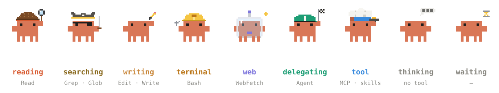
</p>

My mod. When Claude starts subagents, a panel opens and each one shows up as the Claude crab, **dressed for the tool it's using right now**: a detective reading, a pirate searching, an engineer at the terminal, an astronaut on the web. Next to each crab: its task, the file or command it's on, the model, how long it's been running and how many tools it has used. Finished agents fold into a list marked ✓, ✗ or ■.

`/projecte` opens a second panel: a live map of the repository.

- **Now**: what needs you, each item linked to GitHub. PRs ready to merge, failing CI, changes requested, PRs waiting for review and for how long, unreleased commits, stale branches, merged branches to delete. Also the team (one color per person, git identities merged) and every branch with its task, PR, CI and the agents working on it.
- **History**: the project's whole life on the base branch. Each branch is an arc in its author's color, from its first commit to its merge. Releases sit underneath.

It refreshes every two minutes while open, and fetches from GitHub every ten. Animated crabs in the desktop app, a text version in the terminal and VS Code, and the animations stop when the system asks for reduced motion.

```text
/plugin install comunitat --marketplace Jsolee/jsolee-kit
```

> [!NOTE]
> PR data needs [`gh`](https://cli.github.com) signed in; without it the panel still shows branches.

### Mods I run

Other people's mods I keep on every day.

| Mod | What it does | Install |
|---|---|---|
| **filetree** · [data-goblin](https://github.com/data-goblin/claude-code-filetree) | File tree of the session with git status, lines changed, and a shimmer on files Claude touches | `/plugin install filetree --marketplace data-goblin/claude-code-filetree` |
| **savvy-progress** · [JohnnyVizz](https://github.com/JohnnyVizz/claude-kit) | Progress bar above the prompt and a live agents panel. comunitat's crabs come from here. | `/plugin install savvy-progress --marketplace JohnnyVizz/claude-kit` |
| **cache-tax** · [karanb192](https://github.com/karanb192/claude-code-mods) | Stops a cold send once and shows its price, keeps the one-hour prompt cache warm for as long as you set | `/plugin install cache-tax --marketplace karanb192/claude-code-mods` |
| **ponytail** · [DietrichGebert](https://github.com/DietrichGebert/ponytail) | Forces the laziest solution that works: YAGNI, stdlib first, the shortest diff | `/plugin install ponytail --marketplace DietrichGebert/ponytail` |
| **blast-radius** · [Anthropic playground](https://github.com/anthropics/claude-code-playground) | Holds risky shell commands (`rm -rf`, `reset --hard`, force push, migrations) and shows what they'd change, with Proceed and Cancel | see below |
| **replay-theater** · [Anthropic playground](https://github.com/anthropics/claude-code-playground) | Steps through the file edits of the last turn, one diff at a time | see below |

<details>
<summary>Installing the playground mods</summary>
<br>

Their marketplace lives in a subfolder of the repo, so add it from a clone:

```bash
git clone --depth 1 https://github.com/anthropics/claude-code-playground
```

```text
/plugin marketplace add ./claude-code-playground/claude-code/mods
/plugin install blast-radius@claude-code-playground-mods
/plugin install replay-theater@claude-code-playground-mods
```

</details>

<br>

## Prompts to try

Paste these into Claude Code with the kit installed.

```text
Use jsolee-kit to redesign the hero. Pull three references from supahero and land-book,
tell me in one line what you take from each, then build it.
```

```text
Audit this landing against the jsolee-kit house rules and the ship checklist.
List every violation with file and line, then fix them.
```

```text
Add one signature motion moment to the pricing page with GSAP ScrollTrigger.
Honor prefers-reduced-motion and keep everything else still.
```

```text
Use jsolee-kit to build our order-shipped email. Pull references from reallygoodemails,
tell me what you take from each, and make it work in Outlook, in dark mode and with images off.
```

```text
Use jsolee-kit to design a logo for this product. Three ideas in black first, test the best
one at 16 px, then write the one-page brand system into DESIGN.md.
```

```text
I'm about to build an onboarding flow in Expo. Which skills from jsolee-kit should I use, and in what order?
```

<br>

## FAQ

<details>
<summary><b>Does it work with Cursor, Codex or other agents?</b></summary>
<br>

The skill does: `SKILL.md` is plain Markdown, and the `skills` CLI installs it into many agents (drop `-a claude-code` and it asks which). The mods are Claude Code only.

</details>

<details>
<summary><b>Why not copy the 38 skills into this repo?</b></summary>
<br>

Licenses, and freshness. Each skill installs from its author's repo, keeps its license, and stays current with `npx skills update`. This repo only holds what's mine.

</details>

<details>
<summary><b>How do I see or remove what <code>install.sh</code> added?</b></summary>
<br>

`npx skills list` shows what's installed, `npx skills remove <name>` takes one out.

</details>

<details>
<summary><b>This is too loud for my project.</b></summary>
<br>

Then say so. The kit asks for one move you can see from across the room, and it doesn't have to be a color: it can be a layout, a type choice or a working demo. "Make it quieter" works too, through `impeccable`. Product screens people use all day usually want the smaller move.

</details>

<details>
<summary><b>Some rules are too strict for my brand.</b></summary>
<br>

They're mine, built from the tells I kept catching in my own projects. Fork the repo, edit `skills/jsolee-kit/SKILL.md`, and install from your fork. The workflow and the checklist hold up whatever your taste.

</details>

<details>
<summary><b>Will it slow Claude down or eat my context?</b></summary>
<br>

The skill is under 100 lines and only loads for design work. The catalogs in `references/` load only when a step needs them.

</details>

<br>

## Contributing

PRs welcome. For a quick idea, [open a suggestion](https://github.com/Jsolee/jsolee-kit/issues/new?template=suggest-reference.yml) instead. Especially wanted:

- **A reference site**, with one line on what to take from it.
- **A house rule**, with the tell and the fix, ideally as a `diff`.
- **A skill you use every day**, with its repo and when to reach for it.

Keep `SKILL.md` short: if it grows past 100 lines, the extra goes into `references/`.

<br>

## Credits

The skills this kit points to belong to their authors: [Paul Bakaus](https://github.com/pbakaus/impeccable), [Leonxlnx](https://github.com/Leonxlnx/taste-skill), [Emil Kowalski](https://github.com/emilkowalski/skills), [nextlevelbuilder](https://github.com/nextlevelbuilder/ui-ux-pro-max-skill), [GreenSock](https://github.com/greensock/gsap-skills), [HeyGen](https://github.com/heygen-com/hyperframes), [Vercel](https://github.com/vercel-labs/agent-skills), [Resend](https://github.com/resend/resend-skills), [affaan-m](https://github.com/affaan-m/ECC), [obra](https://github.com/obra/superpowers), [zarazhangrui](https://github.com/zarazhangrui/frontend-slides), [Jeffallan](https://github.com/Jeffallan/claude-skills), [glittercowboy](https://github.com/glittercowboy/taches-cc-resources), [kepano](https://github.com/kepano/obsidian-skills) and [Anthropic](https://github.com/anthropics/skills). comunitat's pixel crab and its costumes come from [savvy-progress](https://github.com/JohnnyVizz/claude-kit) by johnnyvizz (MIT; the notice is in [`crab.ts`](plugins/comunitat/hooks/crab.ts)).

<br>

## Star history

<a href="https://star-history.com/#Jsolee/jsolee-kit&Date">
  <picture>
    <source media="(prefers-color-scheme: dark)" srcset="https://api.star-history.com/svg?repos=Jsolee/jsolee-kit&type=Date&theme=dark">
    
  </picture>
</a>

If the kit saved you from one more indigo gradient, a ⭐ helps other people find it.

<br>

<p align="center">
  <sub>MIT · Made by <a href="https://joan-sole.com">Joan Solé</a>, fullstack developer</sub>
</p>
